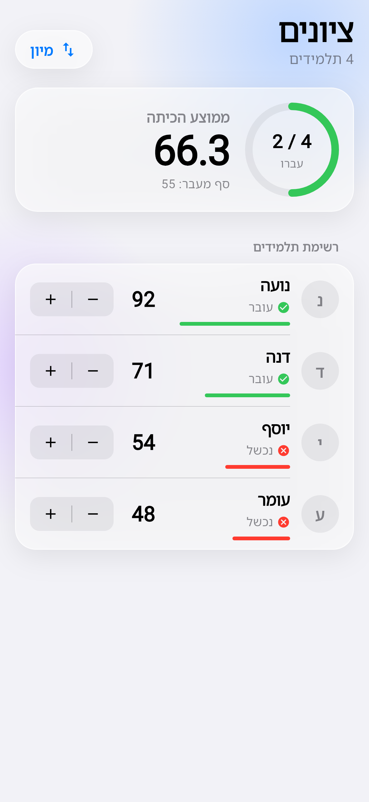
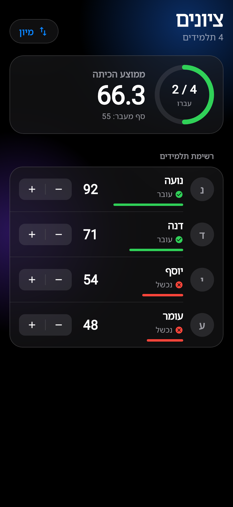

<div align="center">

# ציונים · Grades

**A student grades app for Android & iPhone, built with Flutter — in Hebrew, right-to-left, with an Apple-style design.**

[](https://github.com/saeedkhoury/flutter_grades_1/actions/workflows/ci.yml)


[](LICENSE)

<table>
  <tr>
    <td align="center"><br><sub>Light mode</sub></td>
    <td align="center"><br><sub>Dark mode</sub></td>
  </tr>
</table>

</div>

## Features

| | Feature | Details |
|---|---|---|
| 📊 | **Class average** | Big card at the top; the number counts smoothly to its new value. |
| 🟢 | **Pass ring** | Shows how many students passed, e.g. `2 / 4` (passing grade: **55**). |
| 👤 | **Student rows** | Name, ✓ pass / ✗ fail status, a grade bar, and the grade. |
| ➕ | **Grade stepper** | iOS-style `− \| +` changes a grade by 1, always kept between 0 and 100. |
| ↕️ | **Sort by grade** | Rows slide to their new place; tap again to reverse the order. |
| 📳 | **Haptics** | A light tick on every change, a stronger one when a student crosses the pass line. |
| 🌗 | **Light & dark mode** | Follows the phone's setting automatically. |
| ♿ | **Accessibility** | Screen-reader labels, Reduce Motion, Increase Contrast, and large text sizes. |

## Design

The UI follows Apple's design principles (Human Interface Guidelines and *Designing Fluid Interfaces*), built only with Flutter's own widgets — **no extra packages**.

- **Materials** — frosted "glass" cards (`BackdropFilter` blur + translucent fill + a bright hairline edge) over soft color shapes. They turn solid when *Increase Contrast* is on.
- **Typography** — large title with tight tracking; tabular figures so numbers don't shift while they change.
- **Color** — Apple system colors (`systemGreen`, `systemRed`, `systemBlue`, labels and fills) with separate light and dark values.
- **Motion** — non-bouncy "critically damped" easing; feedback on finger-*down*, not release; sorted rows animate from where they are.
- **Touch targets** — stepper halves are 44 pt wide, Apple's minimum comfortable size.
- **RTL** — the whole app is right-to-left; fractions like `2 / 4` stay left-to-right.

## Getting started

**Requirements:** [Flutter](https://docs.flutter.dev/get-started/install) 3.47 (stable) or newer. For iPhone builds: macOS with Xcode.

```bash
git clone https://github.com/saeedkhoury/flutter_grades_1.git
cd flutter_grades_1
flutter pub get
flutter run            # pick an Android emulator, iPhone simulator, or device
```

## Testing

```bash
flutter analyze        # static analysis — no issues
flutter test           # unit + widget tests
```

The tests cover the grade logic (limits 0–100, pass/fail line, average, sorting) and the screen (average and pass count, `+` / `−` buttons, the 0 limit, and sorting).
They also run automatically on GitHub for every push ([CI workflow](.github/workflows/ci.yml)).

## Project structure

```
lib/
└── main.dart              # The whole app, with a comment on every class and function:
                           #   constants → app & theme → colors (Palette) → Student model
                           #   → GradesScreen → glass card / pressable → header, cards, rows
test/
└── widget_test.dart       # Unit and widget tests
docs/screenshots/          # README images
.github/workflows/ci.yml   # Format, analyze and test on every push
AGENTS.md                  # Rules for AI coding assistants in this project
```

### Code decisions

- **Immutable data** — `Student` never changes; `changeGrade()` returns a new student, and the list is replaced, not edited.
- **Simple state** — one `StatefulWidget` with `setState`, no state-management library.
- **Pure helpers** — `averageGrade()` and `sortByGrade()` are plain functions, easy to test on their own.

## בעברית

אפליקציית ציונים ב-Flutter לאנדרואיד ולאייפון, בעברית ומימין לשמאל, בעיצוב בסגנון אפל.
האפליקציה מציגה את ממוצע הכיתה, כמה תלמידים עברו (ציון עובר: 55), ואת הציון של כל תלמיד.
אפשר לשנות ציון עם כפתורי − / +, ולמיין את התלמידים לפי ציון.
הקוד כולו נמצא בקובץ `lib/main.dart`, עם הערה שמסבירה כל חלק.

## License

[MIT](LICENSE) © 2026 Saeed Khoury
